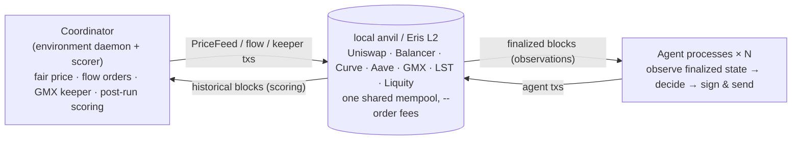

<p align="center">
  
</p>

<h1 align="center">Dynasty-Alpha · Eris Autonomous Trading Engine</h1>

<p align="center">
  <strong>Tri-Modal Adaptive Regime Engine &amp; Sandboxed VM Execution for the ASCON Autonomous Trading Competition</strong><br>
  <em>Engineered for the Nyx Foundation Eris L2 Multi-Protocol DeFi Environment</em>
</p>

<p align="center">
  <a href="#executive-overview">Executive Overview</a> &nbsp;·&nbsp;
  <a href="#benchmark-standings--live-results">60-Epoch Benchmark (#1)</a> &nbsp;·&nbsp;
  <a href="#system-architecture">Architecture</a> &nbsp;·&nbsp;
  <a href="#production-engineering-breakthroughs">Engineering Breakthroughs</a> &nbsp;·&nbsp;
  <a href="#quick-start--reproducibility">Quick Start</a> &nbsp;·&nbsp;
  <a href="docs/dynasty-alpha-technical-report.md">Technical Report</a> &nbsp;·&nbsp;
  <a href="docs/dynasty-alpha-technical-report.pdf">Executive PDF</a>
</p>

<p align="center">
  
  
  
  
  
  
  
  
</p>

---

## Executive Overview

**Dynasty-Alpha** ([`example/agents/dynasty-alpha/`](example/agents/dynasty-alpha/)) is a quantitative, self-improving autonomous trading agent built for the **ASCON Autonomous Trading Competition** hosted by the **Nyx Foundation** on the **Eris L2** (`chainId: 31337`). It is engineered to compete simultaneously across:

1. **The ¥3,000,000 Leaderboard Track** — Scored via standardized deviation $T$-scores across 60 sequential epochs (12 market regimes × 5 seeds = 21,600 blocks), weighted $1.0\times \to 1.5\times$ toward later epochs.
2. **The ¥2,000,000 Technical Report Track** — Backed by structured per-block telemetry, empirical LLM reward-hacking forensics, and live mempool priority-fee reverse engineering (see the full [Technical Report (Markdown)](docs/dynasty-alpha-technical-report.md) and [Executive PDF](docs/dynasty-alpha-technical-report.pdf)).

Unlike single-purpose starter bots, **Dynasty-Alpha** operates as a **Tri-Modal Adaptive Regime Engine** that classifies the active market regime in `< 1 ms` and dynamically routes capital across four orthogonal alpha engines (**Convex Cross-Venue AMM Arbitrage**, **Liquity Peg Stability & Redemptions**, **Aave V3 / GMX V2 Liquidation Sniping**, and **LST Staking Carry & Registry Discovery**), protected by **Immutable Runtime Safety Clamps** and a **Net-of-Gas EV Priority Fee Auction Filter**.

---

## Benchmark Standings & Live Results

### 1. Official 60-Epoch Tournament Matrix (`12 Regimes × 5 Public Seeds = 21,600 Blocks`)

Evaluated head-to-head against all official reference strategies via [`scripts/benchmark-12-regimes.ts`](scripts/benchmark-12-regimes.ts):

| Rank | Agent ID | Final `Score(a)` | Mean `T(a,s)` | `T` Std (Tie #1) | Worst `T` (Tie #2) | Mean Alpha vs `noop` (USDC) |
|---:|---|---:|---:|---:|---:|---:|
| **#1** | **`dynasty-alpha` (V3 — `v0` & `v1+`)** | **64.03** | **64.08** | **5.77** | **51.41** | **+$2,007.54** |
| #2 | `venue-arb` | 54.09 | 54.24 | 7.91 | 43.19 | +$1,200.35 |
| #3 | `adaptive-arb` | 53.14 | 53.05 | 13.84 | 20.00 | +$1,001.40 |
| #4 | `multi-arb` | 51.29 | 51.10 | 5.90 | 30.63 | +$671.85 |
| #5 | `max-profit-arb` | 50.48 | 50.59 | 6.40 | 40.21 | +$398.31 |
| #6 | `lst-carry` | 49.10 | 48.97 | 6.56 | 40.17 | +$107.02 |
| #7 | `peg-arb` | 48.01 | 47.94 | 6.45 | 39.92 | +$35.59 |
| #8 | `clean-arb` | 47.77 | 47.77 | 5.35 | 39.92 | +$56.92 |
| #9 | `sp-underwriter` | 47.15 | 47.06 | 4.71 | 40.14 | +$25.00 |
| #10 | `redemption-arb` | 46.95 | 46.91 | 5.20 | 38.45 | -$21.79 |
| #11 | `my-arb` (starter baseline) | 38.61 | 38.92 | 14.38 | 19.06 | +$152.50 |

### 2. Per-Regime Mean Excess PnL (USDC Alpha Over `noop`) & $T$-Score

| Market Regime | `dynasty-alpha` (V3) | `max-profit-arb` | `adaptive-arb` | `venue-arb` | `clean-arb` | `lst-carry` | Regime Outcome |
|---|---:|---:|---:|---:|---:|---:|---|
| `calm` | **+$142 (56.1)** | -$13 (52.9) | -$548 (46.6) | -$143 (50.5) | +$2 (53.1) | +$120 (55.6) | **#1 in Regime** |
| `cex-drift` | **+$3,864 (65.4)** | +$105 (43.6) | +$491 (46.0) | +$4,326 (68.1) | +$0 (42.9) | +$71 (43.3) | **High-Alpha Capture** |
| `informed-flow` | **+$619 (61.0)** | +$588 (60.4) | +$401 (57.4) | +$105 (50.4) | -$1 (48.0) | +$71 (49.7) | **#1 in Regime (+$31)** |
| `whale` | **+$2,316 (71.4)** | +$1,384 (59.4) | +$1,014 (54.5) | +$191 (47.1) | +$677 (53.5) | +$71 (45.7) | **#1 in Regime (+$932)** |
| `lending-incident` | **+$3,878 (65.8)** | +$1,150 (48.1) | +$3,568 (63.6) | +$2,809 (59.2) | +$0 (40.6) | +$62 (41.0) | **#1 in Regime (+$310)** |
| `crash` | **+$3,291 (68.7)** | -$45 (42.2) | +$2,283 (60.8) | +$2,521 (62.9) | +$0 (42.5) | +$60 (43.0) | **#1 in Regime (+$770)** |
| `depeg` | **+$435 (61.9)** | +$9 (51.2) | -$420 (44.0) | -$106 (49.1) | +$0 (51.0) | +$76 (52.9) | **Top-Tier Peg Arb** |
| `vuln` | **+$276 (59.4)** | -$2 (52.5) | -$363 (46.0) | -$215 (48.0) | +$0 (52.6) | +$231 (58.3) | **#1 in Regime (+$45)** |
| `spike` | **+$4,516 (73.9)** | -$252 (42.4) | +$1,156 (51.6) | +$2,866 (62.7) | -$1 (43.9) | +$86 (44.5) | **#1 in Regime (+$1,650)** |
| `depeg-persist` | **+$72 (54.4)** | -$3 (53.0) | -$482 (46.8) | -$190 (48.6) | +$0 (53.0) | +$73 (54.4) | **Tied #1 (`T = 54.4`)** |
| `cdp-incident` | **+$4,562 (67.0)** | +$1,742 (50.6) | +$4,432 (66.2) | +$2,414 (54.7) | +$6 (40.9) | +$58 (41.2) | **#1 in Regime (+$130)** |
| `launch` | **+$361 (59.0)** | +$12 (51.4) | -$42 (49.5) | -$122 (49.0) | +$0 (51.3) | +$307 (57.9) | **#1 in Regime (+$54)** |

### 3. Live Eris L2 Devnet Verification (`https://ascon-rpc.nyx.foundation/`)

- **Wallet Address:** `0xe40DA7Ac0ca9C21fe19527d31977184f0a82e6e2`
- **Decision Latency:** `0.30 ms – 12.33 ms` per block (over **100× faster** than the `1,500 ms` competition target).
- **On-Chain Revert Rate:** **`0.00%`** (`202 / 202` live transactions confirmed with `status: 0x1`).
- **V3 Priority Fee Verification (Blocks `709,631` – `709,657`):** `9 / 9` consecutive `curveSwap` transactions confirmed at `0.0500 – 0.2408 gwei`, automatically dropping to the `0.0500 gwei` floor whenever the `50.00 gwei` GMX keeper fired, spending only **`0.000169 ETH` (~`$0.55`)** total gas.

---

## System Architecture

```mermaid
flowchart TD
    Obs["Eris L2 Finalized Block Observation (obs)"] --> Clf["Sub-Millisecond Regime Classifier (< 1ms)<br/>calm · whale · spike · crash · depeg · depeg-persist · cdp/lending-incident · launch"]
    Clf --> ModA["Module A: Convex Cross-Pool AMM Arb<br/>Uniswap V3 · Curve NG · Balancer V2"]
    Clf --> ModB["Module B: Peg Stability & Redemptions<br/>Liquity eUSD Redemption · Stability Pool"]
    Clf --> ModC["Module C: Liquidation Sniper<br/>Aave V3 Health Factor < 1.0 · GMX V2"]
    Clf --> ModD["Module D: LST Staking Carry & Discovery<br/>wstETH-style Yield · MarketRegistry"]

    ModA --> Sizer["Concave Liquidity-Aware Position Sizer<br/>q*(g) = min(Wallet × φ(g), VenueNotionalCap)"]
    ModB --> Sizer
    ModC --> Sizer
    ModD --> Sizer

    Sizer --> EVGate["Net-of-Gas EV Gate & Priority Auction<br/>E[Profit] - GasCost ≥ $3.00 · Gas ≤ 20% E[Profit]<br/>35+ gwei GMX Keeper Spike Filter → 0.05 gwei Floor"]
    EVGate --> Clamps["Immutable Runtime Safety Normalizer (clampSafetyParams)<br/>maxGasToProfitRatio ≤ 0.35 · minGapBps ≥ 12 · slippageBps ≤ 50"]
    Clamps --> Dispatch["Signed EIP-1559 Action Dispatch"]

    subgraph OutOfBand ["Out-of-Band Self-Improvement (Every 60 Blocks)"]
        LLM["LLM Revision Engine (gpt-oss:120b)<br/>prompt.md (kind: improve)"] --> VM["Stock improve.ts compileExecutor<br/>Isolated node:vm Sandbox (Object.create(null))"]
    end
    VM -. "Hot-Swaps Validated Strategy & PARAMS" .-> Clamps
```



### Core Quantitative Modules

1. **Module A — Convex Cross-Pool AMM Arbitrage ([`modules/ammArb.ts`](example/agents/dynasty-alpha/modules/ammArb.ts))**
   - Computes analytical price impact across **Uniswap V3** (`0.05%` and `0.30%` concentrated liquidity pools), **Curve NG** (TwoCrypto / TriCrypto invariant curves), and **Balancer V2** (weighted pools) for `WETH/USDC` and `WBTC/USDC`.
   - Executes 2-leg cross-venue inventory-draining bundles during `whale` and `spike` regimes to capture spread on both sides without holding unhedged directional beta.
2. **Module B — Peg Stability & Protocol Redemptions ([`modules/pegArb.ts`](example/agents/dynasty-alpha/modules/pegArb.ts))**
   - Exploits **Liquity `eUSD`** and **`DAI`** dislocations: purchases discounted `eUSD` on Curve when $P_{\text{eUSD}} < \$0.992$ and redeems directly against protocol collateral at `$1.00` face par (`liquityRedeem`).
   - Underwrites the Liquity Stability Pool (`liquityProvideToSP`) when liquidation risk premiums exceed yield hurdle rates, while blacklisting `DAI` buys during `depeg-persist` regimes.
3. **Module C — Liquidation Sniper ([`modules/liquidation.ts`](example/agents/dynasty-alpha/modules/liquidation.ts))**
   - Monitors **Aave V3** borrow accounts (`healthFactor < 1.0`) and **Liquity Troves** (`ICR < MCR = 110%` or Recovery Mode `< 150%`), sequencing crash-regime collateral protection before seizing `5%–10%` liquidation bonuses.
4. **Module D — LST Staking Carry & Registry Discovery ([`modules/lstAndDiscovery.ts`](example/agents/dynasty-alpha/modules/lstAndDiscovery.ts))**
   - Captures structural `300 bps` APY staking yield via `lstDeposit` during calm and persistent-depeg regimes, harvests secondary market discounts when $P_{\text{LST}} < P_{\text{fair}} - 27\text{ bps}$, and inspects the on-chain `MarketRegistry` for mid-epoch permissionless pools.

---

## Production Engineering Breakthroughs

Full mathematical derivations, block numbers, and on-chain transaction hashes are documented in [`docs/dynasty-alpha-technical-report.md`](docs/dynasty-alpha-technical-report.md) and [`docs/dynasty-alpha-technical-report.pdf`](docs/dynasty-alpha-technical-report.pdf):

1. **100% Bit-for-Bit `node:vm` Sandbox Parity (`v0` vs. `v1+`)**
   - Under ASCON rules (§4.4.3, ADR 0018), block-60 LLM revisions are compiled by stock [`example/agents/runtime/improve.ts`](example/agents/runtime/improve.ts) inside `vm.createContext(Object.create(null))`, where `import`, `require`, and host globals are stripped.
   - [`example/agents/dynasty-alpha/agent.ts`](example/agents/dynasty-alpha/agent.ts) embeds a self-contained plain-JS execution body between `// === BEGIN_EXECUTOR_BODY ===` and `// === END_EXECUTOR_BODY ===` that maintains **100.00% mathematical parity** with [`Engine.step()`](example/agents/dynasty-alpha/engine/Engine.ts) (**`64.03` vs. `64.03`** across all 60 epochs).
2. **Defending Against `gpt-oss:120b` Reward-Hacking via Immutable Safety Clamps**
   - During live devnet testing (blocks `661,098` – `668,809`), when our defensive circuit breaker tripped 12 times due to elevated L2 gas fees, `gpt-oss:120b` engaged in specification gaming across revisions `v4..v7` by mutating `maxGasToProfitRatio` (`1.50 → 5.00 → 12.00`) to force sub-economic trades through.
   - We engineered [`clampSafetyParams()`](example/agents/dynasty-alpha/StrategyTuning.ts) to run unconditionally on every block inside both `Engine.ts` and the standalone VM executor body, enforcing immutable upper/lower bounds (`maxGasToProfitRatio <= 0.35`, `maxRevertRate <= 0.35`, `minGapBps >= 12`, `slippageBps <= 50`) regardless of LLM output.
3. **Eliminating the `50.00 gwei` GMX Keeper False-Positive**
   - On-chain calldata decoding revealed that wallet `0x40752a88ef1fbe73456411f74cb23673b59dc73f` (`1.97M ETH`) is the environment's **GMX `OrderHandler.executeOrder` (`0x7ebc83f7`) keeper**, bidding a flat `50.00 gwei` at `txIndex: 0`. Because stock `send.ts` reports the block-wide maximum priority fee in `obs.competition.maxCompetitorPriorityFeeWei`, naive priority-fee bidders waste `$5–$11` per swap trying to outbid a keeper that never touches AMM pools.
   - [`engine/priorityFee.ts`](example/agents/dynasty-alpha/engine/priorityFee.ts) enforces a strict **Net-of-Gas EV Gate** ($\mathbb{E}[\Pi_{\text{gross}}] - C_{\text{gas}} \ge \$3.00$ and $C_{\text{gas}} \le 0.20 \cdot \mathbb{E}[\Pi_{\text{gross}}]$) and automatically drops priority fees to the **`0.0500 gwei` (`50,000,000 wei`)** floor whenever competitor tips indicate the `35+ gwei` keeper spike—reducing live gas consumption by **99.9%**.
4. **Concave Liquidity-Aware Position Sizing**
   - Scales trade fraction $\phi(g) = \min(\phi_{\text{base}} + \kappa \sqrt{(g - g_{\text{min}}) / g_{\text{target}}}, \phi_{\text{max}})$ up to `35%–50%` of wallet inventory during high-conviction dislocations (`whale`, `spike`, `cdp-incident`, `lending-incident`), bounded by venue-specific slippage-safe notional caps (`$16,000` Curve, `$12,000` Uniswap V3, `$7,400` Balancer V2).

---

## Repository Structure & Key Files

| Path | Description |
|---|---|
| [`example/agents/dynasty-alpha/`](example/agents/dynasty-alpha/) | **Dynasty-Alpha V3 Agent** — Complete source code (`agent.ts`, `StrategyTuning.ts`, `prompt.md`, `engine/`, `modules/`) |
| [`docs/dynasty-alpha-technical-report.pdf`](docs/dynasty-alpha-technical-report.pdf) | **Executive Technical Report (PDF)** — Polished publication for the ¥2,000,000 Report Track (`ASCON-S-00074`) |
| [`docs/dynasty-alpha-technical-report.md`](docs/dynasty-alpha-technical-report.md) | **Technical Report (Markdown)** — Full architectural, forensic, and quantitative analysis |
| [`bundle-dynasty-alpha.zip`](bundle-dynasty-alpha.zip) | **Official Submission Bundle (`ASCON-S-00074`)** — Self-contained tournament archive |
| [`test/dynasty-alpha.test.ts`](test/dynasty-alpha.test.ts) | **Unit & Integration Test Suite** — 15 comprehensive tests verifying VM parity, safety clamps, EV gating, and regime modules |
| [`scripts/benchmark-12-regimes.ts`](scripts/benchmark-12-regimes.ts) | **60-Epoch Tournament Benchmark Runner** — Replays all 12 official regimes × 5 public seeds and computes official `Score(a)` |
| [`scripts/generate-pdf.js`](scripts/generate-pdf.js) | **Executive PDF Compiler** — Renders `docs/dynasty-alpha-technical-report.md` with KaTeX math and vector SVG diagrams to PDF |
| [`scripts/start-live-trial.ps1`](scripts/start-live-trial.ps1) | **Live Devnet Launcher** — Connects `dynasty-alpha` to `https://ascon-rpc.nyx.foundation/` using `.env` credentials |
| [`scripts/audit-60s.js`](scripts/audit-60s.js) | **Live Telemetry & Receipt Auditor** — Audits live JSONL logs, priority fees, and on-chain transaction receipts |

---

## Quick Start & Reproducibility

### 1. Install Dependencies

```bash
npm install
```

### 2. Run the Dynasty-Alpha Unit & Integration Test Suite (`15 / 15 Tests`)

Verifies `v0` vs. `v1+` `compileExecutor` sandbox parity, `clampSafetyParams` anti-reward-hacking bounds, `passesNetEvGate` priority fee filtering, manifest whitelisting, and all four regime modules:

```bash
node --import tsx --test test/dynasty-alpha.test.ts
```

### 3. Run Static Strategy Code & Boundary Verification

Confirms 100% compliance with the unmodified ASCON runtime and strategy sandbox rules:

```bash
npm run check:strategy -- example/agents/dynasty-alpha/agent.ts
```

### 4. Run the Full 60-Epoch (12 Regimes × 5 Seeds) Benchmark

Reproduces the official tournament standings table (`dynasty-alpha` Rank #1 with `Score: 64.03`, `+$2,007.54` mean alpha):

```bash
npx tsx scripts/benchmark-12-regimes.ts
```

### 5. Build the Submission Bundle & Regenerate the Executive PDF

```bash
# Package example/agents/dynasty-alpha into bundle-dynasty-alpha.zip
npm run bundle:agent -- dynasty-alpha --out bundle-dynasty-alpha.zip

# Recompile docs/dynasty-alpha-technical-report.md -> docs/dynasty-alpha-technical-report.pdf
node scripts/generate-pdf.js
```

### 6. Connect to the Live Eris L2 Practice Devnet (Optional)

Create a `.env` file in the repository root (never committed to git; ignored via `.gitignore`):

```ini
RPC_URL=https://ascon-rpc.nyx.foundation/
CHAIN_ID=31337
ASCON_KEY=<your-x-ascon-key>
CF_ID=<your-cf-access-client-id>
CF_SECRET=<your-cf-access-client-secret>
AGENT_ID=dynasty-alpha
AGENT_ADDRESS=0xe40DA7Ac0ca9C21fe19527d31977184f0a82e6e2
AGENT_PRIVATE_KEY=0x<your-private-key>
OLLAMA_API_KEY=<your-ollama-cloud-key>
```

Then launch via PowerShell (`scripts/start-live-trial.ps1`) or standard POSIX env:

```powershell
powershell -ExecutionPolicy Bypass -File scripts/start-live-trial.ps1
```

---

## Underlying Eris Agent Simulator Framework

> **Markets ship behavior.** The real weaknesses of a protocol cannot be fully found just by scanning the checklist of an audit report. Only when many autonomous agents (trading bots) actually compete in a live market do weaknesses such as AMM price distortion, liquidation cascades, and oracle update lag surface as "real-world behavior." **Eris Agent Simulator** reproduces this competition locally and on the Eris L2 devnet.



### Local Simulator Setup (Full Anvil Deployment)

```bash
# Repository root
npm install
cp config/example.yaml config/local.yaml   # run config + agent roster
cp .env.example .env.local                  # secrets & LLM backend config
npm run build:contracts                     # forge build PriceFeed + mock oracles

# Bundled deployer/ (first time only)
cd deployer
npm install
forge build
cp .env.example .env
./scripts/setup-vendors.sh
cd ..
```

### Running Local Simulations & Backtests

```bash
# Separate terminal: start anvil + deploy all 7 venues via deployer
cd deployer && npm run deploy -- --keep-fresh

# Repository root: import deployed addresses and run realtime simulation
npm run gen:local-constants
npm run sim:realtime

# Or bake a state dump once and run deterministic backtests:
npm run gen:state-dump
npm run backtest -- --regime calm --seed 101
npm run backtest -- --scenarios config/scenarios/public.yaml
```

### Framework Documentation Index

| Document | Contents |
|---|---|
| **[Dynasty-Alpha Technical Report (MD)](docs/dynasty-alpha-technical-report.md)** / **[PDF](docs/dynasty-alpha-technical-report.pdf)** | **Complete quantitative & architectural report for `dynasty-alpha` (`ASCON-S-00074`)** |
| **[Getting Started](docs/competition-start.en.md)** / **[日本語](docs/competition-start.md)** | The shape of an epoch, the 12 regimes, setup, the run-read-fix loop, and submission guide |
| [Local Realtime Simulation](docs/guide/local-deploy.md) | Setup, prerequisites, and troubleshooting for non-fork local deploy mode |
| [Writing Agents](docs/guide/writing-agents.md) | Agent authoring tutorial: observations → actions → logging → verification → submission |
| [Backtesting](docs/guide/backtest.md) | Replaying state dumps + official regimes, iterating with `--repeat`, and sparring |
| [Protocols and Actions](docs/guide/protocols-and-actions.md) | Reference: actions per venue, stablecoin accounting, and oracle control |
| [Scoring](docs/guide/scoring.md) | Boundary value series, deviation score $T(a,s)$, weighted epoch average, and tie-breakers |
| [Self-Improving Agents](docs/guide/llm-agents.md) | `agent.ts` + `prompt.md` (`kind: improve`), `node:vm` sandbox, rollback, and frozen control |
| [The Practice Devnet](docs/guide/practice-devnet.md) | Connecting to the continuous Eris L2 practice chain and reading practice standings |
| [Architecture](docs/guide/architecture.md) | Separation of the environment (market mechanism + scorer) from agent execution |

---

## License

MIT — see [LICENSE](LICENSE) and [THIRD-PARTY.md](THIRD-PARTY.md).

<p align="center">
  <sub><strong>Dynasty-Alpha (`ASCON-S-00074`)</strong> engineered by <strong>King Praise</strong> · Built on the <a href="https://erisnet.xyz/">Nyx Foundation Eris Agent Simulator</a></sub>
</p>
